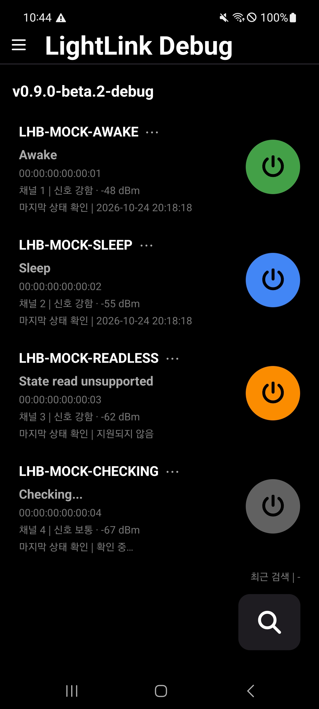
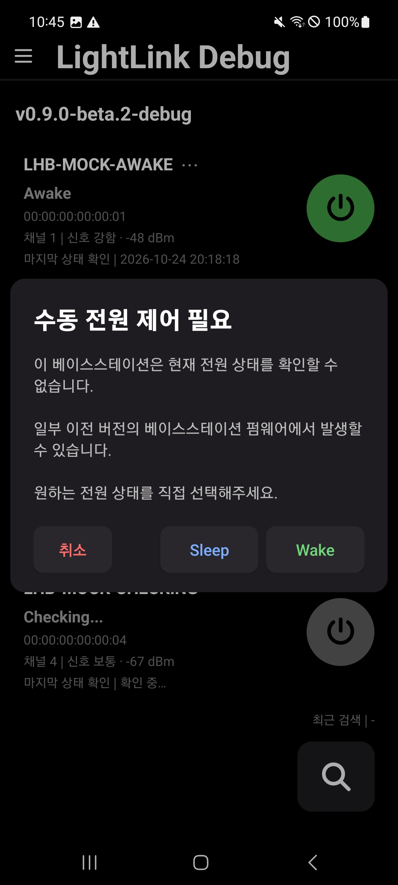
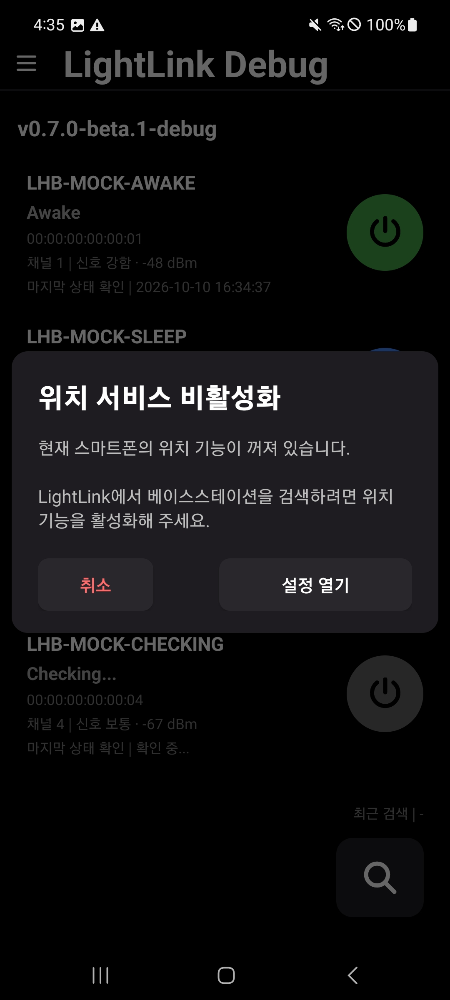

# LightLink

An Android app for controlling SteamVR Base Station 2.0 over Bluetooth Low Energy (BLE).

LightLink는 Bluetooth Low Energy(BLE)를 이용해 SteamVR Base Station 2.0을 검색하고 전원을 제어하는 **Android 전용 앱**입니다.

**Version:** `v0.7.0-beta.1` · **Status:** Beta · **Android:** 8.0 (API 26)+

## Download / 다운로드

**[Download APK from GitHub Releases](https://github.com/TBeco/LightLink/releases)**

Download the `.apk` file from the **Assets** section of a release.

GitHub Releases에서 해당 버전의 **Assets**에 있는 `.apk` 파일을 다운로드하면 됩니다.

LightLink is still in beta, and compatibility may vary between devices.

현재 베타 버전으로, 기기에 따라 동작에 차이가 있을 수 있습니다.

## Screenshots / 스크린샷

|                     Main Screen / 메인 화면                     |                       Manual Power Control / 수동 전원 제어                        |                       Permission Dialog / 권한 안내창                       |
|:--------------------------------------------------------------:|:---------------------------------------------------------------------------------:|:--------------------------------------------------------------------------:|
|  |  |  |

## Why I Made LightLink / 개발 배경

I started LightLink because the Base Station power management app I was using didn't always work well on my phone.

Sometimes, it couldn't find some of my base stations, even after scanning again. I wanted something that would work reliably on the Android phone I already had, so I decided to try building my own app.

That's how LightLink started.

The discovery issue has improved in my setup, and I'm still testing how well the app works on other Android devices and Base Station firmware versions.

기존 Base Station 전원 관리 앱을 사용하면서 제가 사용하던 스마트폰에서 일부 베이스스테이션이 검색되지 않는 문제를 겪었습니다.

다시 검색해도 나타나지 않는 경우가 있었고, 현재 사용 중인 스마트폰에서도 안정적으로 동작하는 앱을 직접 만들어 보고 싶었습니다.

그렇게 LightLink를 개발하기 시작했습니다.

현재 제 사용 환경에서는 기존 검색 문제가 상당 부분 개선되었으며, 다른 Android 기기와 Base Station 펌웨어에서도 정상적으로 동작하는지 테스트하고 있습니다.

## Features / 주요 기능

- Discover nearby Base Station 2.0 devices / 주변 베이스스테이션 검색
- Read the power state when supported / 지원되는 장치의 현재 전원 상태 확인
- Wake or Sleep each base station independently / 베이스스테이션별 전원 켜기(Wake) 및 절전(Sleep) 제어
- Start and stop scanning manually / 검색 시작 및 중지
- Show RF channel, Bluetooth signal strength (RSSI), and last successful state check time / 베이스스테이션 채널(RF Channel), 블루투스 신호 강도(RSSI), 마지막 상태 확인 시각 표시
- Retry temporary Bluetooth connection failures / 일시적인 블루투스 연결 실패 시 재시도
- Verify power state after Wake / Sleep commands when supported / 지원되는 장치에서 전원 명령 후 실제 상태 재확인
- Allow manual Wake / Sleep control when older firmware does not support Power State READ / 일부 구형 펌웨어에서 상태 조회가 불가능할 때 수동 전원 제어

## Planned Features / 개발 예정 기능

The following features are planned but are not available in the current version.

- **Language support:** Add Korean and English language options throughout the app.
- **Base Station identification:** Identify a specific base station by selecting it in the app and making its LED blink white. This feature requires further testing of device and firmware support.

다음 기능들은 현재 개발을 고려하고 있으며, 아직 구현되지 않았습니다.

- **다국어 지원:** 앱의 화면과 안내 메시지에 한국어 및 영어 지원 추가
- **베이스스테이션 식별:** 앱에서 특정 베이스스테이션을 선택하면 해당 장치의 LED가 흰색으로 점멸하여 실제 장치를 쉽게 구분할 수 있도록 하는 기능. 장치 및 펌웨어의 지원 여부를 추가 확인할 예정입니다.

These plans may change depending on testing results and technical limitations.

개발 예정 기능은 테스트 결과나 기술적인 제약에 따라 변경될 수 있습니다.

## Compatibility / 호환성

- **Supported / 지원:** SteamVR Base Station 2.0
- **Not supported / 미지원:** SteamVR Base Station 1.0

My main test setup uses Base Station 2.0 with firmware **3008**. Testers have also reported working results with firmware **3002**, although compatibility has not been fully verified across all features and devices.

주요 테스트 환경은 펌웨어 **3008**의 Base Station 2.0입니다. 테스터를 통해 **3002**에서도 동작을 확인했지만, 모든 기능과 환경에서의 호환성 검증이 끝난 것은 아닙니다.

Some older firmware versions may not support Power State READ. If BLE write commands are available, LightLink can still send Wake / Sleep commands manually, but it cannot verify the resulting power state.

일부 오래된 펌웨어에서는 전원 상태 읽기(Power State READ)를 지원하지 않을 수 있습니다.

이 경우 BLE 쓰기(Write)가 가능하다면 수동으로 Wake / Sleep 명령을 보낼 수 있지만, 명령 실행 후 실제 전원 상태를 확인할 수는 없습니다.

## Requirements / 실행 환경

- Android 8.0 (API 26) or later / Android 8.0 이상
- Bluetooth Low Energy (BLE) support / BLE 지원 기기
- Required Bluetooth permissions / 필요한 블루투스 권한
- Precise location permission / 정확한 위치 권한
- Device location services enabled / 스마트폰 위치 기능 활성화

These location requirements reflect LightLink's current BLE scanning setup.

위치 관련 조건은 현재 LightLink의 BLE 검색 방식에 따른 요구 사항입니다.

## Tested Android Devices / 테스트한 Android 기기

- Samsung Galaxy S9
- Samsung Galaxy A51 5G
- Samsung Galaxy S23 Ultra
- Samsung Galaxy S25 Edge
- Samsung Galaxy Z Flip6
- Samsung Galaxy Z Fold2
- Samsung Galaxy Z Fold4
- Samsung Galaxy Z Fold8

This list includes devices used for testing. It does not guarantee that every feature works identically on each model.

위 목록은 테스트에 사용한 기기이며, 모든 모델에서 모든 기능이 동일하게 동작한다는 의미는 아닙니다.

## Privacy / 개인정보

LightLink does not require an account or cloud connection. Base station discovery and control happen locally over BLE.

계정이나 클라우드 연결 없이 사용할 수 있으며, 베이스스테이션 검색과 전원 제어는 기기 간 BLE 통신으로 이루어집니다.

## Development & Feedback / 개발 및 피드백

LightLink is a personal project that I'm currently developing on my own.

I'm not planning to accept code contributions for now, but bug reports and suggestions are welcome through [GitHub Issues](https://github.com/TBeco/LightLink/issues).

When reporting a problem, please include your Android device model, Android version, Base Station firmware version (if known), and how to reproduce the issue.

LightLink는 현재 혼자 개발하고 있는 개인 프로젝트입니다.

당분간 외부 코드 기여를 받을 계획은 없지만, 버그 제보와 개선 의견은 [GitHub Issues](https://github.com/TBeco/LightLink/issues)를 통해 받고 있습니다.

문제가 발생했다면 스마트폰 모델, Android 버전, 베이스스테이션 펌웨어 버전(확인 가능한 경우), 문제 발생 과정을 함께 알려주세요.

## Reference / 참고자료

The following reference was helpful when working with the Base Station 2.0 BLE GATT services, characteristics, and power control commands.

Base Station 2.0의 BLE GATT 서비스, 특성(Characteristic), 전원 제어 명령을 구현하면서 아래 자료를 참고했습니다.

- [BenWoodford — Lighthouse 2.0 GATT Information](https://gist.github.com/BenWoodford/3a1e500a4ea2673525f5adb4120fd47c)

## Disclaimer / 안내

LightLink is an independent, unofficial project and is not affiliated with or endorsed by Valve Corporation.

LightLink는 개인이 개발한 비공식 앱이며 Valve Corporation과 관계가 없습니다.
